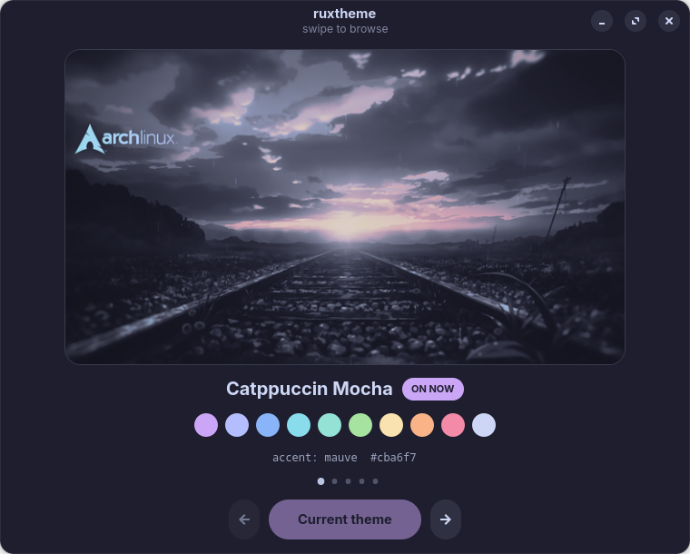
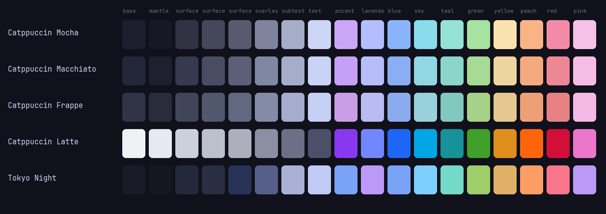

# ruxtheme

Switch an entire Linux desktop between colour themes from one palette file.

One command repaints the terminal, notifications, launcher, GTK apps, the GNOME Shell,
the prompt, the system monitor, the desktop widgets and the browser start page, then
live-reloads whatever is running. No logout, no reinstalling themes, no hunting through
fifteen config files for a hex code.





> **Scope, honestly.** The engine is general. The templates shipped here are **my own
> desktop's configs** (a Lua/cairo Conky HUD, my GNOME Shell theme, my start page), used
> as a working reference set. Fork it and replace `templates/` with yours. See
> [Making it yours](#making-it-yours) for the tool that converts existing configs into
> templates automatically.

## The problem

My desktop was Tokyo Night in nine different places: Conky Lua tables, a kitty theme
file, rofi `.rasi` variables, a mako config, waybar CSS, GTK3 and GTK4 CSS, a GNOME
Shell stylesheet, and a browser start page. Changing theme meant editing every one by
hand and getting them subtly out of sync. There was no source of truth.

## How it works

```
palettes/catppuccin-mocha.env     one file, 26 colours + accent
          |
          |  envsubst, with an explicit variable list
          v
templates/*.tmpl   ->   ~/.config/kitty/current-theme.conf
                        ~/.config/gtk-4.0/gtk.css
                        ~/.themes/<you>/gnome-shell/gnome-shell.css
                        ... 16 files in total
          |
          v
   live reload: kitty SIGUSR1, makoctl reload, waybar SIGUSR2,
   conky restart, gsettings for GTK / icons / wallpaper
```

Every colour in every template is a token like `${ct_base}`, `${ct_accent}` or
`${ct_mauve}`. Each palette also exposes three forms of every colour, because different
config formats want different things:

| Form | Example | Used by |
|---|---|---|
| `${ct_accent}` | `#cba6f7` | most configs |
| `${ct_accent_h}` | `cba6f7` | hyprlock `rgba(cba6f7cc)` |
| `${ct_accent_rgb}` | `203,166,247` | CSS `rgba(…, 0.16)` |
| `${ct_accent_rgbs}` | `203;166;247` | fastfetch ANSI `38;2;…` |

### Why `envsubst` with an explicit variable list

`envsubst "$vars"` is passed the exact list of `ct_*` names and nothing else. That is
what stops it eating Conky's `${cpu}`, starship's `$directory` or any other `$` syntax
that legitimately belongs in the config. Substituting blindly corrupts half these files.

## Themes

Catppuccin **Mocha**, **Macchiato**, **Frappé** and **Latte**, all with the **Mauve**
accent, plus **Tokyo Night** kept as a fifth option.

Light and dark are handled properly, not faked. Latte flips `color-scheme` to
`prefer-light`, swaps the icon theme to the light variant, and the wallpaper pipeline
switches from additive glows to alpha blending so a light wallpaper does not blow out
to white.

### A test that the refactor changed nothing

The wallpaper generator was originally hard-coded to Tokyo Night. After parameterising
it, regenerating the Tokyo Night wallpaper and diffing it against the original gave:

```
differing pixels: 0 of 8294400
max channel delta: 0
identical
```

Rendering the Tokyo Night palette also reproduces 11 of 12 original configs byte for
byte. The twelfth is a genuine palette mismatch, documented in [Known limits](#known-limits).

## What gets themed

| Target | File |
|---|---|
| kitty | `~/.config/kitty/current-theme.conf` |
| rofi | `~/.config/rofi/config.rasi` |
| mako | `~/.config/mako/config` |
| waybar | `~/.config/waybar/style.css` |
| hyprlock | `~/.config/hypr/hyprlock.conf` |
| GTK3 | `~/.config/gtk-3.0/gtk.css` |
| GTK4 / libadwaita | `~/.config/gtk-4.0/gtk.css` |
| GNOME Shell | `~/.themes/<name>/gnome-shell/gnome-shell.css` |
| Conky widgets | `common.lua`, `hud.lua`, `lab.lua` |
| fish / fzf | `~/.config/fish/config.fish` |
| fastfetch | `~/.config/fastfetch/config.jsonc` |
| btop | `~/.config/btop/themes/ruxtheme.theme` |
| starship | `~/.config/starship.toml` |
| browser start page | `index.html` |
| icons | generated Papirus folder-colour variant |
| wallpaper | per-theme, built by the pipeline |

## Install

Requires: `bash`, `gettext` (for `envsubst`), `python`, and `gsettings` for the GNOME
parts. The carousel needs GTK 4 and libadwaita (`python-gobject`).

```sh
git clone https://github.com/Siddique-12300983/ruxtheme
cd ruxtheme
./install.sh
```

`install.sh` copies the engine into `~/.local/bin`, the palettes and templates into
`~/.config/ruxtheme`, and backs up every file it will later overwrite into
`~/.config/ruxtheme/backup/`. It does **not** apply a theme; run `ruxtheme set` for that.

Nothing needs root.

## Usage

```sh
ruxtheme list                  # all themes, * marks the active one
ruxtheme set catppuccin-mocha  # apply
ruxtheme next                  # cycle forward (dark -> light)
ruxtheme toggle                # flip dark <-> light
ruxtheme show catppuccin-latte # print a palette as colour swatches
ruxtheme wallpaper <theme> <image>   # rebuild a theme's wallpaper
```

### Switching from the desktop

Three ways, because a keyboard shortcut is not always what you want:

- **`Super+Alt+T`** opens the carousel, a GTK4 `Adw.Carousel` window showing each
  theme's wallpaper and palette. Arrow keys browse, Enter applies.
- **`Super+Alt+Shift+T`** toggles dark and light directly.
- **Quick Settings** gets a *Theme* entry from the small GNOME Shell extension in
  `extension/`. It lists every theme, shows which is live, and opens the carousel.

The extension is deliberately 150 lines and written for this job, rather than pulling in
a general-purpose "run a command" extension.

## Making it yours

`tools/tokenise.py` is the one-shot script that turned my hard-coded configs into
templates. Point it at your own files, give it a map of your current hex values to
palette tokens, and it rewrites them as `${ct_*}` templates, backing up the originals
first. It handles `#rrggbb`, 8-digit hex with alpha, bare hex inside `rgba()`, decimal
`rgba(r, g, b, a)` and ANSI `38;2;r;g;b` triplets.

It converted 236 colour references across 16 files here.

`tools/gen_palettes.py` generates the `.env` palette files from the canonical colour
values, including the derived forms and blended shades. Add a flavour there rather than
hand-writing an `.env`.

## Known limits

- **GTK4 apps need restarting** to pick up new colours. GTK reads `gtk.css` at startup.
- **New GNOME Shell extensions need a session restart** on Wayland. The keybindings and
  carousel work immediately; the Quick Settings entry appears after logging back in.
- **One palette mismatch.** Tokyo Night has more distinct surface shades than Catppuccin,
  so waybar's `#414868` restores as `#292e42` when switching back to Tokyo Night. Mapping
  it to Catppuccin's `surface1` is the visually correct choice; exact round-tripping for
  every flavour would need per-flavour overrides for every slot.
- The Conky templates assume my widget layout. The wallpaper pipeline scrims the regions
  where those widgets sit and composites an Arch logo at fixed coordinates, because
  `left.lua` anchors its column to it. Adjust `lib/make-wallpaper.py` for your own layout.

## Credits

- **[Catppuccin](https://github.com/catppuccin/catppuccin)** for the Mocha, Macchiato,
  Frappé and Latte palettes (MIT). The colour values in `palettes/catppuccin-*.env` are
  theirs; the packaging around them is mine.
- **[Tokyo Night](https://github.com/folke/tokyonight.nvim)** by Folke Lemaitre (MIT),
  the palette this desktop started from.
- **[Papirus](https://github.com/PapirusDevelopmentTeam/papirus-icon-theme)** (GPL-3.0).
  `lib/build-icons.sh` symlinks Papirus' own colour variants into a new theme; it does
  not copy or modify their artwork.
- **[orangc's Catppuccin wallpapers](https://github.com/orangci/walls-catppuccin-mocha)**
  are what I use on my own desktop. **They are not included in this repo** — that
  collection states no licence, so it is not mine to redistribute. `wallpapers.map.example`
  shows the mapping and the README there explains how to fetch them.
- `lib/wallpaper.py` is derived from the procedural wallpaper generator in my
  [dotfiles](https://github.com/Siddique-12300983/ruxchipher-dotfiles), parameterised so
  the art follows the palette.

## Licence

MIT, see [LICENSE](LICENSE). This covers my code: the engine, the carousel, the
extension, the tooling and the templates. It does not extend to the upstream palettes,
icon artwork or wallpapers credited above, which keep their own terms.
